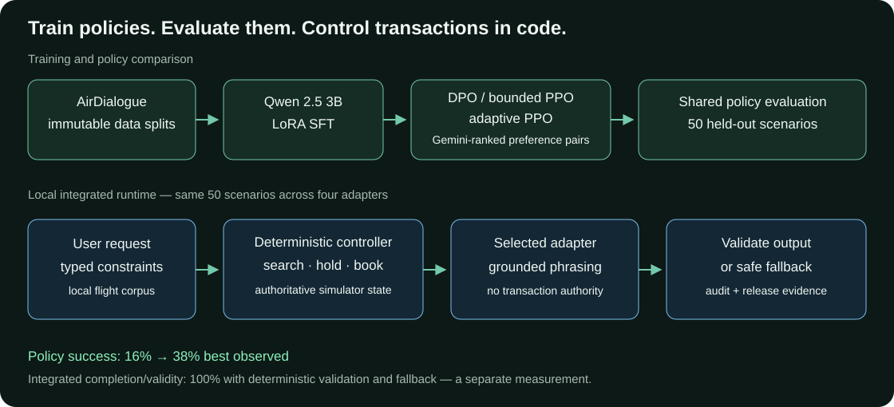

# RLAIF Flight Dialogue Alignment & Safety System

Flight-dialogue models can invent inventory or claim a booking they did not
execute. This project trains and compares Qwen 2.5 3B alignment policies, then
places response generation inside a deterministic controller that owns simulator
state, search, holds, and bookings. The release includes shared evaluations,
output validation, safe fallbacks, and hash-pinned evidence. The supported local
application is under `local_app/`; training and evaluation are under
`rebuild/rlaif/`.

**Ownership:** the current Qwen 2.5 3B rebuild is solo work by Shubham Kumar
Agrawal; its historical Mistral-7B predecessor was a three-person team project.

## Architecture



## Results: two evaluation layers

| Layer | Cohort | Observed result | Interpretation |
|---|---|---|---|
| Policy-only | Same 50 held-out scenarios per policy | Base **16%**, SFT **26%**, DPO **34%**, PPO checkpoint 19 **38%**, adaptive PPO **34%** task success | Model-policy results from historical summary evidence; 95% intervals overlap and judge metrics are mixed. |
| Integrated local system | Same 50 scenarios × four adapters = **200 scenario runs** | **100% completion**, valid search/booking transitions, valid displayed outputs, and grounded-entity precision; **zero** unsupported transaction claims and displayed repetition | Includes deterministic validation and safe fallback. This is system reliability, not standalone model accuracy. |
| Release checks | Local application and rebuild suites | **340 + 85 = 425 automated tests** in recorded closeout evidence; release gate passed | Evidence is linked below; a fresh test run does not rerun model training or the integrated model matrix. |

Preference generation retained **386 validated pairs from 700 scenarios**.
DPO had the lowest integrated fallback rate (**7.5%**). See the
[policy results](rebuild/cloud/FINAL_RESULTS.md) and
[integrated release report](RLAIF_2_RELEASE_REPORT.md) for denominators,
confidence intervals, and per-adapter measurements.

## Short local demo

After the quickstart below, open `http://127.0.0.1:8000/` and use scenario 0:

1. `Find a flight from IAD to LAS under $100`
2. `My name is Amy Gonzalez`
3. `Book flight 9999` — the controller rejects an ID outside the current results.
4. `Book flight 1027` — the controller confirms a simulated booking.

This demo uses the deterministic local path and no external services. To compare
adapter phrasing, model mode requires the pinned model and adapter files already
present locally; see [runtime details](#local-conversation-runtime).

## Quick start

Clone the canonical repository and start the dependency-free deterministic path
with Python 3.11 or newer:

```sh
git clone https://github.com/shubhamkragrawal/rlaif-flight-dialogue.git
cd rlaif-flight-dialogue
python3 -m venv .venv
.venv/bin/python -m local_app.server
```

Open `http://127.0.0.1:8000/`. The server is localhost-only and every booking is
simulated. Optional local-model dependencies are pinned in
`requirements-local.txt`; they are not needed for this quickstart. Run all
regression entry point with Python 3.11+ and Node.js 18+:

```sh
./scripts/full-local-regression
```

The recorded **425-test** closeout ran in the original complete workspace. Some
tests still expect the original `airdialogue_sampled_5k.jsonl` corpus and archived
cloud job JSON files that are absent from the public checkout; a fresh clone
cannot reproduce the complete suite without those inputs. The packaged 50-scenario
corpus supports the quickstart and simulator demo. The release gate below verifies
the recorded evidence and hashes; it does not rerun these tests.

## Evidence and release verification

- [Final release report](RLAIF_2_RELEASE_REPORT.md): model/system boundaries,
  results, and limitations.
- [Integrated 50-by-4 matrix](artifacts/matrix/releases/v1/release-v1.json) and
  [identity/checksum manifest](artifacts/matrix/releases/v1/manifest-v1.json).
- [Six-check evidence bundle](artifacts/release/evidence-v1-20261012T005310274515Z/evidence-v1.json)
  and [passing release gate](artifacts/release/gate-v1/release-gate-v1.json).
- [Local operations](OPERATIONS.md): verify the recorded hashes and reproduce
  the supported checks; [release contract](artifacts/release/README.md).
- [Project overview](PROJECT_OVERVIEW.md) and
  [implemented local-system contract](LOCAL_CONVERSATION_SYSTEM_SPEC.md).

## Limitations

- **38% is policy-only task success; 100% is integrated system completion and
  validity after validation/fallback.** Neither is evidence of airline production
  operation, live inventory access, or real transactions.
- Historical policy evidence is summary-level: raw scenario outputs and verified
  byte-level links from the historical evaluated policies to the local adapters
  are unavailable. The integrated matrix has its own local adapter/model hashes.
- The 50-scenario policy comparison is small, confidence intervals overlap, and
  judge scores/booking metrics do not support a blanket quality-improvement claim.
- Hash-pinned release artifacts identify model, adapter, corpus, and controller
  bytes. They do not record a Git commit SHA; see the release contract before
  treating a tag as proof of the exact evaluation-time checkout.
- Model files are not bundled or downloaded at startup. The default demo is
  fully usable without a model or cloud account.

## Repository guide

The historical/rebuild package contains:

- `shared/` loads immutable data splits and prompts.
- `data/` prepares training data.
- `preferences/` generates and validates AI preference pairs.
- `rewards/` contains grounded PPO rewards and bounded judge retries.
- `training/` contains PEFT SFT, DPO, PPO, and adaptive PPO.
- `evaluation/` contains the common held-out evaluation runner.
- `tests/` contains CPU and configuration tests.

Cloud job JSON files under `rebuild/cloud/` preserve historical experiment arguments,
resource limits, historical image tags, and GCS prefixes. Their command fields
were normalized to the reorganized `rlaif.*` module paths, so they are archival
parameter records rather than byte-for-byte submission manifests and cannot run
against the historical flat-layout images. No cloud account is required to run,
test, evaluate, or verify the completed local release. Historical code and logs
under `baseline/` and `vertex_ai_logs/` are retained for provenance and are not
supported entry points.

The checked-in `rebuild/artifacts/dataset_manifest.json` records SHA256 hashes for
the corpus, split file, and SFT examples. Training and evaluation refuse changed
corpus/split inputs. Historical runs did not pin a Hugging Face model commit;
new closeout preparation requires `--model-revision` and records the resolved
revision when the model loads. See [REPRODUCIBILITY.md](rebuild/cloud/REPRODUCIBILITY.md).

## Historical cloud jobs

These tools are retained for historical reproducibility and are not needed by
the local release. Use `rebuild/cloud/prepare.py` and
`rebuild/cloud/prepare_ppo_adaptive.py` to generate isolated configs in a new
output directory. These scripts only generate files; they do not submit jobs.
For final post-restructure metadata and a fresh image context, use
`rebuild/cloud/prepare_closeout.py` with a new v14-or-later tag, suffix, and
pinned model revision. Submit only bounded JSON configs after checking the
budget ledger in `rebuild/cloud/budget.json`.

Historical measured results and GCS locations are documented in
`rebuild/cloud/FINAL_RESULTS.md` and `PROJECT_OVERVIEW.md`.

## Results at a glance

All five final policies used the same 50 held-out scenarios. The observed task
success rates are directional because their 95% intervals overlap. PPO 19 is
the last accepted checkpoint before the original trainer's update gate stopped
the run; PPO 50 is the completed adaptive continuation.


The judge score provides a second view of the same evaluations; it does not
rank the policies in the same order as task success.


The curves below come from the rebuilt runs' saved training logs. SFT and DPO
optimize different objectives, so their loss values should not be compared to
each other. PPO reward is an on-policy training signal, not held-out task success.


The preference quality gates retained 386 of 700 scenarios as training pairs.
DPO's in-training pair accuracy is shown separately from held-out task success.


See [figure provenance and regeneration](figures/README.md) for source files,
checks, and limitations.

## Local conversation runtime

The local runtime is under `local_app/`. It uses the
checked-in AirDialogue scenarios as a deterministic flight knowledge base and
never contacts an airline, payment provider, model endpoint, or cloud service.
The controller owns all tool actions and state transitions. A selected Qwen/PEFT
adapter may phrase grounded responses, but guardrail failures fall back to the
deterministic controller response.

After the environment has been created, use:

```sh
.venv/bin/python -m unittest discover -s local_app/tests -p 'test*.py'
.venv/bin/python -m local_app.server             # deterministic, http://127.0.0.1:8000
.venv/bin/python -m local_app.server --model     # lazy MPS model inference
.venv/bin/python -m local_app.cli --adapter dpo --model
```

Model mode is strictly local-only: it does not download a base model or adapter.
It requires the pinned Qwen revision to already exist in the Hugging Face cache
and adapter files under `local_models/{sft,dpo,ppo_checkpoint_19,ppo_adaptive_50}`.
If those files are unavailable, deterministic mode remains fully usable. The
legacy `local_app.download_adapters` helper refers to the historical private GCS
bucket and is not part of the supported closeout workflow.

The browser regressions BR006 and BR007 also require Node.js 18 or newer on
`PATH`. Set `RLAIF_NODE` to the Node executable if it is not on `PATH`. They
execute the shipped browser script with Node's built-in `node:vm` and a
behavioral DOM harness; no npm package is required. These tests fail with a
prerequisite error if Node.js is unavailable.

The API exposes `GET /health`, `GET /adapters`, `POST /sessions`,
`GET /sessions/{id}`, `POST /sessions/{id}/messages`, and
`POST /sessions/{id}/reset`. `GET /` serves a small browser UI. It binds to
localhost by default. Booking is simulator-only and requires a flight returned
by the current local search. Redacted audit events go to `.local/audit.jsonl`
by default; set `RLAIF_AUDIT_LOG` to change the path.

The local ML profile pins the final evaluation's resolved Qwen revision
`aa8e72537993ba99e69dfaafa59ed015b17504d1`. Adapter files live under ignored
`local_models/{sft,dpo,ppo_checkpoint_19,ppo_adaptive_50}`. The base model cache
is `local_models/huggingface`; startup uses local files only. Only one policy is
kept in memory at a time for the validated 16 GB Apple Silicon profile.

Run a deterministic controller-only evaluation with:

```sh
.venv/bin/python -m local_app.evaluation --count 50 --adapter sft \
  --output outputs/local-regression-sft.json
```

This report is a controller/simulator regression, not a replacement for the
model-policy held-out evaluations in `rebuild/cloud/FINAL_RESULTS.md`.

## Final local release

The final integrated release ran the same 50 scenarios across all four local
adapters on Apple MPS. Every arm completed all scenarios with 100% task
completion, 100% validation of user-visible responses, and zero repetitive
user-visible output. Rejected model candidates were recorded and replaced by
the authoritative deterministic controller response; fallback rate therefore
remains a model-quality signal rather than a hidden safety failure.

Key artifacts:

- `artifacts/matrix/releases/v1/release-v1.json` — complete 50-by-4 matrix.
- `artifacts/evaluation/policy-only-v1.json` — historical summary-level policy
  evidence, explicitly incomplete because raw scenario records are absent.
- `artifacts/release/evidence-v1-20261012T005310274515Z/evidence-v1.json` — six
  passing local release checks.
- `artifacts/release/gate-v1/release-gate-v1.json` — final gate result (`pass`).

See [RLAIF_2_RELEASE_REPORT.md](RLAIF_2_RELEASE_REPORT.md) for per-adapter
metrics, provenance, and limitations.
